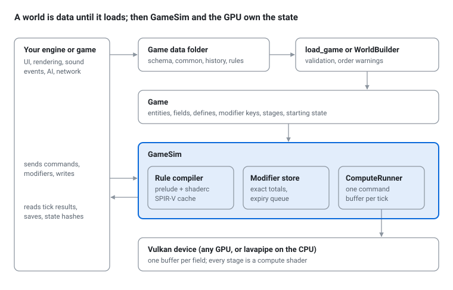

# Terni

**Deterministic, GPU-accelerated simulation for grand-strategy games.**

Terni runs the tick of a strategy game — pops, markets, armies, realms — as Vulkan
compute shaders, and gives **bit-identical results on every GPU and CPU**. That makes
it fast enough for millions of simulated entities and exact enough to drive
**lockstep multiplayer**: peers exchange only commands, never state.

A game is described as data, in the Paradox script syntax many strategy modders
already know, plus GLSL rules. Terni turns that description into shaders when the
game loads, so mods can change the rules themselves, not only the numbers.



## Why Terni

- **Exact everywhere.** 32-bit fixed point, integer atomics and stateless randomness:
  the same world gives the same state hash on NVIDIA, AMD, Intel and the CPU (Mesa's
  lavapipe), across saves and over the network.
- **Fast at scale.** One pre-recorded command buffer per tick. In Terni's benchmark, a
  world of 1 million pops computes a tick in 0.58 ms on a laptop RTX 4050 and 0.16 ms on
  a desktop RTX 4070 Ti: 54 and 182 times faster than the same simulation in C++ on one
  CPU thread. Even with every pop copied back to system memory every tick, the RTX 4070
  Ti is 2.6 times faster than all 16 threads of a Ryzen 7800X3D. `terni_bench` measures
  your own hardware ([Benchmark](docs/benchmark.md)).
- **Data-driven and moddable.** Entities, fields, constants, modifiers, starting
  state and stage order come from text files; rules are GLSL. Errors are reported as
  `file:line`, and a checksum over everything that defines behaviour keeps saves and
  multiplayer peers honest.
- **Engine-agnostic.** A C++20 library with no engine dependency. Your engine draws,
  plays sound and runs the UI; Terni owns the simulation state.
- **Paradox-style modifiers.** Additive, scalable, timed modifier bundles with
  inheritance in one or more steps (a province inherits from its district, region and
  realm), totals kept exact and tooltips
  answered without waiting for the GPU.
- **Determinism checks built in.** A warning at load time for rules whose result can
  depend on GPU thread order, and a checked tick that proves it at run time.
- **Entities that come and go.** Armies, pops or fleets are created and destroyed during
  play, by rules or by your engine, with the same rows on every machine.
- **Runs without a GPU too.** Ship a software Vulkan driver and the same rules run on
  the CPU with the same results; a simulation can also move to another device while it
  runs, when its GPU gets busy.
- **Ships without a shader compiler.** Compile the rules at build time; players'
  machines only load SPIR-V (`Terni::runtime`, no shaderc needed).

## Status

Terni is **pre-1.0 (0.1.0)**: the core is tested and has been used by several games
in development, but the API can still change between versions.

| Platform | Status |
| --- | --- |
| Linux | Developed and tested here: NVIDIA (proprietary driver), AMD (RADV), lavapipe |
| Windows | Visual Studio 2022 and 2026 (MSVC), and MinGW-w64 (MSYS2). Continuous integration runs the whole test suite with both, on lavapipe; parity also checked on an NVIDIA and an AMD GPU |
| macOS, consoles, web | Not supported |
| GPUs | Vulkan 1.3 with synchronization2; no 64-bit shader features needed. Intel: the benchmark gives identical results on an HD Graphics 620; the test suite has not yet run on an Intel GPU |

## Quick start

```sh
cmake -S . -B build -G Ninja && cmake --build build
ctest --test-dir build                        # unit tests and GPU parity on every Vulkan device
./build/hello_towns                           # a world described in code
./build/terni_run examples/mini_galaxy --ticks 100 --dump   # a world from a data folder
./build/terni_check examples/mini_galaxy tests/data/galaxy_mods/good_mod   # check a mod before publishing
./build/terni_bench                           # how fast your GPUs and CPU run a grand-strategy tick
```

Requirements: CMake 3.21+, a C++20 compiler (GCC, Clang, or Visual Studio 2022 or
2026), the Vulkan loader and headers, and shaderc (`libshaderc` and `glslc`). The tools
also need OpenMP.
See [Getting started](docs/getting-started.md) for packages per system.

## Using Terni in your game

```cmake
add_subdirectory(external/terni)                    # or FetchContent, see docs/embedding.md
target_link_libraries(my_game PRIVATE Terni::core)  # or Terni::runtime: no shaderc at run time
```

```cpp
auto game = terni::load_game("data/my_game");        // errors as file:line in game->errors
terni::GameSim sim(*game);                            // compiles the rules, picks a GPU
const uint32_t province = uint32_t(game->entity_index("province"));
uint32_t pops = sim.read_each_tick(province, "pop");  // results copied back with every tick
sim.tick();
std::span<const int32_t> pop = sim.tick_result(pops);
```

## Engine plugins

[TerniIntegrations](https://github.com/ZBager/TerniIntegrations) has plugins that run
a Terni game folder from an engine's own scripting and editor, without touching Vulkan
or the C++ API:

| Engine | Plugin |
| --- | --- |
| Flax Engine 1.13 | C++, C# and Visual Scripting; a Terni window in the editor; cooked games |
| Godot 4.5+ | GDScript and C#; a Terni tab in the debugger; exported games |
| Unreal Engine, Unity | Planned |

Both run the simulation on the GPU the engine renders with, start and tick it without
holding up frames, and ship the rule compiler with the game so mods can change rules.
They are tested on Linux and Windows.

## Documentation

| Guide | What it covers |
| --- | --- |
| [Getting started](docs/getting-started.md) | Build, run the examples, write your first world |
| [Concepts](docs/concepts.md) | Entities, fields, stages, the tick, modifiers, who owns what |
| [Data format](docs/data-format.md) | `schema/`, `common/`, `history/` and `rules/` in detail |
| [Writing rules](docs/writing-rules.md) | The generated GLSL names, fixed point, sums, randomness, the GLSL library |
| [Embedding in an engine](docs/embedding.md) | Devices, the per-tick loop, shipping, saves, lockstep multiplayer; the ready-made engine plugins |
| [Determinism](docs/determinism.md) | The contract, order checks, parity testing |
| [API reference](docs/api.md) | The public types and calls (lower-level details are in the headers) |
| [Design](docs/design.md) | Why Terni is built this way, and what it measured |
| [Benchmark](docs/benchmark.md) | Measure Terni on your hardware against a CPU implementation of the same world |
| [Roadmap](docs/roadmap.md) | What comes next |
| [Licensing](docs/licensing.md) | What a game using Terni may do and must do |

## Licence

Copyright (C) 2026 Rafał Zając.

Terni is licensed under the GNU Lesser General Public License, version 2.1 only
([`LICENSE`](LICENSE)), with the Terni Linking Exception
([`LICENSE-EXCEPTION`](LICENSE-EXCEPTION)). Use it in any game, open or closed, free or
paid, on any platform, linked statically or dynamically; you do not have to let players
relink or reverse engineer your game, and the shaders compiled from your rules are
yours. Changes to Terni itself, including modules added to it, must be published under
the LGPL, and games must credit Terni. [Licensing](docs/licensing.md) explains it in
plain words.

Contributions are welcome: see [CONTRIBUTING.md](CONTRIBUTING.md).
