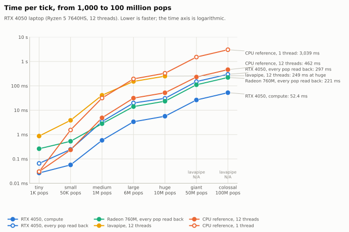
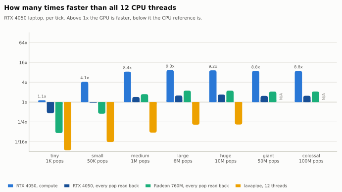
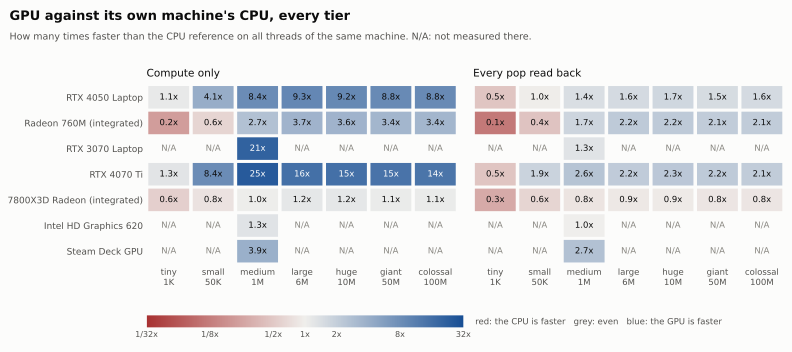
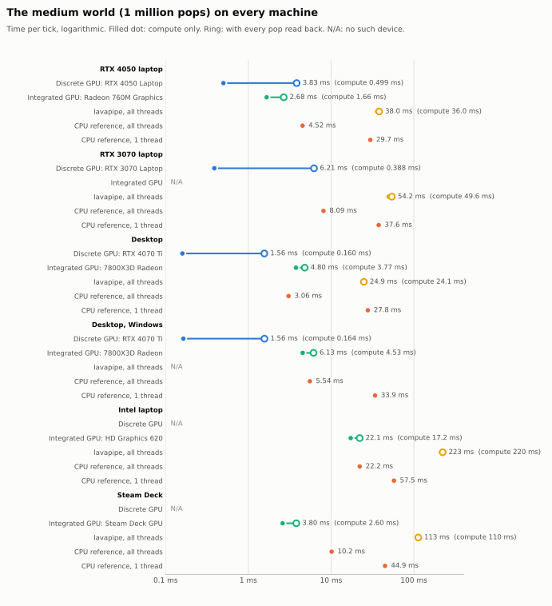

# Benchmark

`terni_bench` measures how fast Terni runs a grand-strategy tick on your hardware, and
compares it with a CPU implementation of the same simulation. Anyone can run it, and
results from different machines can be compared.

Every result is checked. Each run must end with the same state hash as the others:
Terni on every Vulkan device, and the CPU reference at every thread count. A run whose
state differs is reported as invalid, not given a time.

## Run it

`terni_bench` is built by default when Terni is the top-level project
(`-DTERNI_BUILD_BENCHMARK=ON`). Build in Release, which is also the default:

```sh
cmake -S . -B build -G Ninja && cmake --build build
./build/terni_bench                    # the medium world (the baseline), every device, 1 to all CPU threads
./build/terni_bench --size large --json results.json
./build/terni_bench --list             # the sizes and the Vulkan devices
```

Close games, browsers with video, and anything else that uses the GPU first: a busy GPU
can make ticks many times slower. On a laptop, plug it in and use its performance
power mode.

| Option | Meaning |
| --- | --- |
| `--size NAME` | `tiny`, `small`, `medium` (default), `large`, `huge`, `giant` or `colossal` |
| `--provinces N`, `--pops-per-province N`, `--empires N`, `--markets N` | Change the size (the world is then called `custom`) |
| `--seed N` | Another starting state (default 1) |
| `--ticks N`, `--warmup N` | Ticks measured, after ticks not measured: 100 and 20, fewer for `huge` and larger (see the sizes below) |
| `--device I` | Only this Vulkan device (repeatable); `--no-gpu` for none |
| `--driver LIBRARY` | Add a Vulkan driver library, such as lavapipe |
| `--lavapipe-threads N` | Threads of Mesa's lavapipe (sets `LP_NUM_THREADS`) |
| `--threads LIST` | CPU reference thread counts: `1,2,8`; `powers` (default: 1, 2, 4, ... and all); `sweep` (every count from 1 to all); `all` |
| `--no-cpu` | No CPU reference |
| `--readback WHAT` | What comes back to system memory every tick: `pops` (default; every field of every pop, as a host that keeps a copy of the whole world would, and what `ui` reads) or `ui` (only province unrest and empire treasuries, as a game's map and interface would read) |
| `--stages` | Also print the GPU time of every stage |
| `--json FILE` | Also write the results, the machine and the versions as JSON |

The exit code is 0 when every run finished with the same state, and 1 otherwise. A
device that cannot start the world, because it is too large for it, is shown as
skipped and does not change the exit code.

## The world

A small grand-strategy economy, built in code from a size and a seed
(`bench/bench_world.cpp`):

| Entity | Count (medium) | What it does |
| --- | --- | --- |
| Pop | 1,000,000 (100 per province) | Works a job making one of 8 goods, earns, pays tax, buys what it needs, grows or shrinks, changes job when unhappy |
| Province | 10,000 | Sums its pops, pays its empire, gains unrest, sometimes raises an army |
| Market | 500 | Sets a price for each good from supply and demand |
| Empire | 100 | Keeps a treasury, pays for armies and administration, changes its tax once a month |
| Army | up to 2,500, created and destroyed as provinces revolt | Wears down, is paid for, calms its province |

The sizes (`medium` is the baseline: the size results are quoted and compared at):

| Size | Provinces | Pops | Empires | Markets | Fields | Ticks (warm-up + measured) |
| --- | ---: | ---: | ---: | ---: | ---: | --- |
| `tiny` | 64 | 1,024 | 4 | 8 | 0.04 MiB | 20 + 100 |
| `small` | 1,000 | 50,000 | 20 | 50 | 1.6 MiB | 20 + 100 |
| `medium` | 10,000 | 1,000,000 | 100 | 500 | 31 MiB | 20 + 100 |
| `large` | 30,000 | 6,000,000 | 300 | 1,500 | 185 MiB | 20 + 100 |
| `huge` | 50,000 | 10,000,000 | 500 | 2,500 | 308 MiB | 10 + 50 |
| `giant` | 100,000 | 50,000,000 | 1,000 | 5,000 | 1.5 GiB | 5 + 30 |
| `colossal` | 100,000 | 100,000,000 | 1,000 | 5,000 | 3.0 GiB | 5 + 30 |

`huge`, `giant` and `colossal` are there to find the limits of a machine:

- Their fields must fit in the GPU's memory.
- One field of their pops must fit in a single storage buffer. lavapipe allows 128 MiB,
  so it runs `huge` but skips `giant` and `colossal`.
- The CPU reference takes seconds per tick on one thread, which is why these sizes
  measure fewer ticks.
- `colossal` needs about 7 GiB of RAM, and a run of every device and thread count takes
  a few minutes.

Each tick runs eight stages, using what real games use:

- stages with one thread per row, over pops, armies, markets and empires;
- a workgroup stage, in which 256 threads sum each province's pops;
- sums into other rows through integer atomics;
- modifiers with timed instances, inherited from empire to province;
- `rng_roll`;
- 64-bit treasuries;
- a monthly stage;
- dynamic entities, with Terni's built-in stages handing out new rows.

Before every tick, the host adds a few modifiers for events (harvests, famines,
reforms). With every tick, every pop comes back to system memory, as a host that keeps
a copy of the whole world would want; `--readback ui` brings back only two fields, as a
game's map and interface would read.

The world has a version, printed as `terni_bench 1`. When the world, its rules or the
host's events change, the version goes up. Compare results only between runs with the
same version and size.

## The CPU reference

`bench/cpu_reference.cpp` runs the same eight stages in plain C++. It is written the way
a careful CPU engine would be:

- flat arrays in the same layout as Terni's, with no allocation per entity;
- the same fixed-point and random functions (`terni::fx`, `terni::rng`);
- a pool of threads created once, with each stage's rows split statically between them;
- the large sums (pops' goods to markets, provinces' taxes to empires) kept per thread
  and combined after the stage, where Terni uses atomics; the small ones (armies,
  administration costs) through atomics, as in Terni.

After every tick its state is bit-identical to Terni's.

It is a fair baseline, not the fastest CPU code possible:

- It runs the same stages in the same order and does not fuse loops.
- It has no hand-written SIMD.
- It is compiled for the baseline instruction set (no `-march=native`), as a game
  shipped to players would be.

Loops with too little work to be worth waking threads for run on fewer threads, or on
the calling thread alone; so do the stages over empires, which are few.

## Reading the results

```
                                                 total ms           p10 - p90  compute ms  vs 1 CPU  start ms
NVIDIA GeForce RTX 4050 Laptop GPU                  3.408       3.281 - 3.870       0.580      9.2x       ...
```

| Column | Meaning |
| --- | --- |
| total ms | Median time of a tick as the host sees it: compute, readback to system memory, and submitting and waiting (with the host's events) |
| p10 - p90 | The spread of total ms: 10 % of ticks were faster than the first number, 10 % slower than the second |
| compute ms | Median time of the stages alone, from GPU timestamps. The CPU reference has nothing to read back, so for it compute and total are the same |
| vs 1 CPU | How many times faster than the CPU reference on one thread, by total ms |
| start ms | Creating the simulation, with the rules loaded from a SPIR-V cache (the compile time, done once, is printed above the table); for the CPU reference, copying the starting state |

Things to keep in mind:

- **Small worlds favour the CPU.** A tick on a GPU costs a submission and a wait, a few
  hundredths of a millisecond to a few tenths, however little work it has. In the
  `tiny` world the CPU reference wins easily. Terni pays off as worlds grow.
- **lavapipe is not the CPU reference.** lavapipe runs the same compute shaders on the
  CPU. That is what makes Terni work on machines without a usable GPU, but shaders
  written for a GPU run more slowly there than C++ written for the CPU. Workgroup
  stages with barriers are the slowest part. `--lavapipe-threads` and `--threads` with
  the same count compare the two on the same cores.
- **Total and compute differ** by the readback, the cost of submitting and waiting, and
  the host's events. Most of it is the readback: by default every pop field comes back
  every tick, 31 MiB at `medium` and 3 GiB at `colossal`. On a discrete GPU that
  crosses PCIe and costs more than the compute itself; on an integrated GPU, which
  shares the system's memory, it costs less. What came back is checked against the
  state after the last tick. The CPU reference has its state in system memory already,
  so it is the same in both modes.
- **Read back only what the host needs.** With `--readback ui`, only what a game's map
  and interface would show comes back, a few hundred KiB at most, and total is close to
  compute. Games that also start a tick and collect it a frame later (`begin_tick()` /
  `end_tick()`) hide most of what is left.
- **Thread counts past the physical cores** use SMT (Hyper-Threading), which adds less
  than a core. The header shows physical cores and threads.

## Charts

The charts show the reference results below; the tables there hold every number in
them. Where a machine has no result for a device or a size, the chart says N/A.

### Every population tier

<picture>
  <source media="(prefers-color-scheme: dark)" srcset="images/benchmark/tiers-time-dark.svg">
  
</picture>

Only in the smallest world is the CPU reference faster than every GPU: a GPU tick costs a
submission and a wait, however little work it has. From a million pops up, the RTX 4050
computes a tick 54 to 58 times faster than one CPU thread, and every line rises about as
steeply as the world grows. Reading every pop back costs it about five times its
compute, yet it stays ahead of all twelve threads at every size from `medium` up.

<picture>
  <source media="(prefers-color-scheme: dark)" srcset="images/benchmark/tiers-speedup-dark.svg">
  
</picture>

Against all twelve CPU threads, the GPU's lead stops growing at about a million pops:
the RTX 4050 computes 8 to 9 times faster from there on, and 1.4 to 1.7 times faster with
every pop read back. The integrated Radeon 760M, which reads back from the memory it
shares with the CPU, is faster than the RTX 4050 from `medium` up once everything comes
back.

### Every machine and tier

<picture>
  <source media="(prefers-color-scheme: dark)" srcset="images/benchmark/speedup-map-dark.svg">
  
</picture>

Each GPU against the CPU reference on all threads of its own machine. The RTX 4050
laptop and the desktop have results at every tier; the other three machines were
measured at `medium` only. The discrete GPUs compute faster from 50,000 pops up;
reading every pop back narrows their lead to 1.3 to 2.6 times from `medium` up. The
7800X3D's two-compute-unit integrated GPU is at best about as fast as its own CPU.

### The baseline on every machine

<picture>
  <source media="(prefers-color-scheme: dark)" srcset="images/benchmark/medium-machines-dark.svg">
  
</picture>

The medium world on every machine, one row per approach. A filled dot is the compute
alone, a ring the total with every pop read back; the line between them is the cost of
the readback.

The charts are drawn by `python3 bench/charts/make_charts.py` (it needs matplotlib) from
`bench/charts/results.csv`; `bench/charts/add_results.py` adds a machine's JSON files to
that table.

## Reference results

`terni_bench 1`, with each size's default ticks, on five machines with Linux, GCC 16,
NVIDIA driver 620.70 and Mesa 26.2 (RADV, the Intel driver and lavapipe):

- **RTX 4050 laptop**: Ryzen 5 7640HS (6 cores, 12 threads), Radeon 760M integrated GPU,
  RTX 4050 Laptop GPU. Every size.
- **Desktop**: Ryzen 7 7800X3D (8 cores, 16 threads), its integrated Radeon GPU (2
  compute units), RTX 4070 Ti. Every size; a web browser and a chat program were open
  during these runs, so its times may be a little high.
- **RTX 3070 laptop**: Ryzen 5 5600H (6 cores, 12 threads), RTX 3070 Laptop GPU.
- **Intel laptop**: Core i5-7200U (2 cores, 4 threads, from 2016), Intel HD Graphics 620
  integrated GPU.
- **Steam Deck**: its AMD APU (4 Zen 2 cores, 8 threads, and an integrated RDNA 2 GPU with
  8 compute units), with SteamOS; built and run in an Arch Linux container (Distrobox).

Every run ended in the same state as every other at the same size, on every machine:
`medium` (hash `83415c984147cf51`) on all five, every size on the RTX 4050 laptop and the
desktop.

### `medium`, the baseline

Every pop read back each tick (the default):

| RTX 4050 laptop | Total ms | Compute ms | vs 1 CPU thread |
| --- | ---: | ---: | ---: |
| RTX 4050 Laptop | 3.41 | 0.58 | 9.2x |
| Radeon 760M | 2.80 | 1.83 | 11x |
| lavapipe, 12 threads | 41.1 | 38.4 | 0.8x |
| CPU reference, 1 thread | 31.5 | | 1x |
| CPU reference, 2 threads | 16.0 | | 2.0x |
| CPU reference, 4 threads | 8.55 | | 3.7x |
| CPU reference, 8 threads | 6.40 | | 4.9x |
| CPU reference, 12 threads | 4.87 | | 6.5x |

| Desktop | Total ms | Compute ms | vs 1 CPU thread |
| --- | ---: | ---: | ---: |
| RTX 4070 Ti | 1.55 | 0.16 | 19x |
| Ryzen 7800X3D integrated Radeon | 4.82 | 3.84 | 6.1x |
| lavapipe, 16 threads | 25.5 | 24.4 | 1.1x |
| CPU reference, 1 thread | 29.3 | | 1x |
| CPU reference, 2 threads | 15.0 | | 2.0x |
| CPU reference, 4 threads | 7.85 | | 3.7x |
| CPU reference, 8 threads | 5.42 | | 5.4x |
| CPU reference, 16 threads | 3.97 | | 7.4x |

| RTX 3070 laptop | Total ms | Compute ms | vs 1 CPU thread |
| --- | ---: | ---: | ---: |
| RTX 3070 Laptop | 6.21 | 0.39 | 6.1x |
| lavapipe, 12 threads | 54.2 | 49.6 | 0.7x |
| CPU reference, 1 thread | 37.6 | | 1x |
| CPU reference, 2 threads | 19.2 | | 2.0x |
| CPU reference, 4 threads | 11.0 | | 3.4x |
| CPU reference, 8 threads | 8.22 | | 4.6x |
| CPU reference, 12 threads | 8.09 | | 4.6x |

| Intel laptop | Total ms | Compute ms | vs 1 CPU thread |
| --- | ---: | ---: | ---: |
| Intel HD Graphics 620 | 22.1 | 17.2 | 2.6x |
| lavapipe, 4 threads | 223 | 220 | 0.3x |
| CPU reference, 1 thread | 57.5 | | 1x |
| CPU reference, 2 threads | 28.9 | | 2.0x |
| CPU reference, 4 threads | 22.2 | | 2.6x |

| Steam Deck | Total ms | Compute ms | vs 1 CPU thread |
| --- | ---: | ---: | ---: |
| Steam Deck GPU | 3.80 | 2.60 | 12x |
| lavapipe, 8 threads | 113 | 110 | 0.4x |
| CPU reference, 1 thread | 44.9 | | 1x |
| CPU reference, 2 threads | 22.6 | | 2.0x |
| CPU reference, 4 threads | 11.8 | | 3.8x |
| CPU reference, 8 threads | 10.2 | | 4.4x |

What they show:

- **The time to read every pop back depends on the PCIe link.** The RTX 4070 Ti
  computes a tick 25 times faster than all 16 threads of the 7800X3D, and reads back at
  about 23 GB/s: with every pop read back it is still 2.6 times faster. The RTX 4050
  reads back at about 11 GB/s, 1.4 times faster than its 12 CPU threads in all. The RTX
  3070 Laptop computes faster than the RTX 4050 (0.39 ms against 0.58 ms) but reads
  back at about 5.5 GB/s, so in all it takes 6.2 ms, still 1.3 times faster than its 12
  CPU threads.
- **Integrated GPUs differ widely.** The Radeon 760M (8 compute units) shares the
  system's memory, reads back cheaply, and is 1.7 times as fast as its 12 CPU threads.
  The 7800X3D's 2-compute-unit Radeon only matches its CPU. The 2016 HD Graphics 620
  computes a tick 1.3 times faster than all four CPU threads, and with every pop read
  back the two are even. The Steam Deck's GPU is 2.7 times faster than its 8 CPU threads
  with every pop read back, the largest lead of an integrated GPU here: its CPU is small,
  and reading back from shared memory costs it about 1 ms.
- **lavapipe** computes 6 to 11 times slower than the C++ on the same threads.
- **SMT helps unevenly.** From 8 to 12 threads the 5600H gains almost nothing, the
  7640HS about 30 %.

With `--readback ui` (only province unrest and empire treasuries come back), total ms
against compute ms:

| `medium`, `--readback ui` | Total ms | Compute ms |
| --- | ---: | ---: |
| RTX 4070 Ti | 0.18 | 0.14 |
| RTX 3070 Laptop | 0.57 | 0.42 |
| RTX 4050 Laptop | 0.65 | 0.58 |
| Radeon 760M | 1.87 | 1.75 |
| Ryzen 7800X3D integrated Radeon | 3.90 | 3.83 |
| Intel HD Graphics 620 | 17.6 | 17.2 |
| Steam Deck GPU | 2.86 | 2.59 |

### Every size

The two machines measured at every size; total ms with every pop read back, and the
compute ms in brackets:

| RTX 4050 laptop | RTX 4050 Laptop | Radeon 760M | lavapipe, 12 threads | CPU, 1 thread | CPU, 12 threads |
| --- | ---: | ---: | ---: | ---: | ---: |
| `tiny` | 0.065 (0.027) | 0.262 (0.136) | 0.870 | 0.030 | 0.030 |
| `small` | 0.246 (0.057) | 0.530 (0.376) | 3.85 | 1.54 | 0.235 |
| `medium` | 3.41 (0.580) | 2.80 (1.83) | 41.1 | 31.5 | 4.87 |
| `large` | 19.8 (3.35) | 14.1 (8.57) | 152 | 193 | 31.3 |
| `huge` | 30.7 (5.66) | 23.4 (14.3) | 249 | 329 | 52.0 |
| `giant` | 150 (26.3) | 111 (67.1) | N/A | 1,518 | 231 |
| `colossal` | 297 (52.4) | 221 (134) | N/A | 3,039 | 462 |

| Desktop | RTX 4070 Ti | 7800X3D integrated Radeon | lavapipe, 16 threads | CPU, 1 thread | CPU, 16 threads |
| --- | ---: | ---: | ---: | ---: | ---: |
| `tiny` | 0.061 (0.023) | 0.100 (0.051) | 0.837 | 0.027 | 0.028 |
| `small` | 0.141 (0.031) | 0.419 (0.328) | 3.11 | 1.44 | 0.261 |
| `medium` | 1.55 (0.161) | 4.82 (3.84) | 25.5 | 29.3 | 3.97 |
| `large` | 9.62 (1.33) | 23.5 (17.6) | 94.5 | 178 | 20.8 |
| `huge` | 15.0 (2.28) | 38.8 (29.5) | 155 | 307 | 35.1 |
| `giant` | 74.3 (11.2) | 192 (148) | N/A | 1,485 | 163 |
| `colossal` | 152 (22.5) | 382 (292) | N/A | 2,972 | 318 |

From `large` up, a tick costs about the same per pop. Compute alone, the RTX 4050 is
about 58 times faster than one CPU thread and 9 times faster than twelve; the RTX 4070
Ti about 130 times faster than one thread and 14 to 16 times faster than sixteen.
Reading every pop back takes five to six times as long as the compute, and even so the
RTX 4050 stays about 1.6 times faster than its twelve threads and the RTX 4070 Ti about
2.2 times faster than its sixteen. lavapipe is N/A at `giant` and `colossal`: one pop
field is larger than the 128 MiB a buffer may have there.

`colossal` with `--readback ui`, every pop staying on the GPU: the RTX 4070 Ti takes
22.5 ms per tick, the RTX 3070 Laptop 25.4 ms (24.8 ms compute), the RTX 4050 53.0 ms,
the Radeon 760M 133 ms, the Steam Deck 161 ms and the HD Graphics 620 688 ms, after a
42-second start, all in the same state (hash `efd84db0206e40e3`). With every pop read
back the HD Graphics 620 is skipped: the 3 GiB of state and two 3 GiB readback buffers do
not fit in the memory it shares with the CPU (`vkAllocateMemory` fails).

## Sending in results

Results from other hardware are welcome, above all from GPUs not listed here. Run
`terni_bench --json results.json` (the `medium` world; other sizes too if you have the
time), then open an issue with the
[benchmark result template](https://github.com/ZBager/Terni/issues/new?template=benchmark-result.md)
and attach the JSON file. Besides the results, it holds the CPU and GPU names, the GPU
drivers, core counts, the operating system and its kernel version, the compiler and the
Terni commit, and nothing else about the machine.
