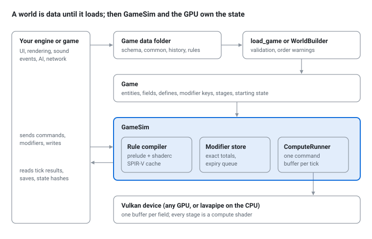

# Concepts

A Terni **world** is a set of entity types with typed columns, a list of compute
**stages** that run in order once per **tick**, and a store of **modifiers**. The world
is described once, as data or in code; from then on the state lives on the GPU and
your engine talks to it through `GameSim`.

## Who owns what

| Terni | Your engine |
| --- | --- |
| The simulation state: every field of every entity, on the GPU | Rendering, UI, sound, input, networking |
| The tick: all stages, in order, in one GPU submission | When to tick (every frame, every N ms, paused) |
| Modifier totals and expiry | Deciding *when* modifiers change: research, events, policies |
| Saves of the simulation state, the game checksum | Your own state on top (settings, chat, UI) |

Work that needs a graph search or a decision (pathfinding, AI choices, applying a
player's order) usually belongs to the host. It reads the results of the last tick,
decides, and sends commands back with `write_field` and `add_modifier`. Those take
effect at the start of the next tick, on every peer the same way.

## Entities, rows and capacity

An **entity type** (planet, province, pop, army) is a table. Each entity is a **row**,
identified by its index. Every type has a fixed **capacity** (the most rows it can
hold), set in the schema, and a **count** (the rows in use), set by the starting state.

- Stages visit rows `0 … count-1` of their entity type.
- A game that offers several map sizes changes capacities before it starts:
  `game->set_capacity(province, 16384)`. The rules do not have to be compiled again;
  one compiled set serves every size.
- By default counts are fixed while the simulation runs. An entity type whose rows come
  and go (armies, pops that split) is marked **dynamic**; see below.
- A **ref** field holds the row index of another entity (a planet's `owner`). That is
  how the world is linked together.

### Entities that come and go

Mark an entity type `dynamic = yes` and its rows can be created and destroyed during
play. Each row is then **alive** or not, and loops visit only the rows that are alive.

- **Destroying** is immediate: a rule calls `army_destroy(a)`, usually on its own row,
  or the host calls `destroy_entity`. The row's modifier instances are removed.
- **Creating** happens at the end of a tick, in a fixed order, so that every machine
  gives the same row to the same request. A rule asks by setting a count field
  (`province_raise[p] = 2u` asks for two armies); the host asks with `create_entity`.
  A new row is alive from the next tick, with every field at its default.
- A new entity takes the **lowest free row**. A destroyed row rests for one tick before
  it is free again, so rules that hold a ref to it get a tick to see that it is gone.
  After that the row is reused, and the ref would point at a different entity. Every
  row has a **generation**, the number of times it has been created; a row and its
  generation together name one entity for good.
- The **count** of a dynamic type is one past the highest row ever alive. It grows and
  never shrinks; the capacity is still the limit, and a request that does not fit
  waits.
- Who is alive, the generations and the counts are part of the state: saves hold them,
  and they are compared between devices like any field.

## Fields

Every field is one or more 32-bit values per row, so it maps directly to GPU memory.

| Type | Stored as | Use for |
| --- | --- | --- |
| `quantity` | Q24.8 fixed point (`int`) | People, goods, money: anything counted with fractions |
| `rate` | Q16.16 fixed point (`int`) | Ratios, prices, percentages, modifier values |
| `agg` | `int`, whole units | Sums over many entities (see [Determinism](determinism.md)) |
| `int` | `int` | Plain integers, flags, enumerations |
| `count` | `uint` | Non-negative counters |
| `ref:<entity>` | `uint` | The row of another entity |
| `money64` | 64-bit integer as `uvec2` (low, high) | Values past 2^31, such as a treasury |

A field can hold several values per row (`size = 6`: six goods per province). In GLSL
the values of row `i` are at `i * SIZE + k`.

Why fixed point and not floats: floating-point results differ between GPUs, drivers
and compilers; integer results do not. See [Design](design.md).

## Constants (defines)

A **define** is a named constant of one of the types above (`growth_rate = rate`),
with its value in `common/` (`growth_rate = 0.02`). Rules read it as `D.growth_rate`;
host code reads the same raw value with `game.define("growth_rate")`.
Keeping balance numbers in defines lets mods change them without touching rules, and
they are part of the game checksum.

## Stages and the tick

A **stage** is one GLSL compute shader. `rules/stages.txt` lists the stages in the
order they run; each names the entity type it runs `for_each`, which sets how many
GPU threads it gets.

One **tick** is:

1. Host changes since the last tick are uploaded (field writes, modifier totals).
2. Fields listed in the `clear = { ... }` of a stage that runs in this tick, or in a
   `clear` line of their own with a schedule, are set to zero (accumulators).
3. Every stage runs in order, with a memory barrier between stages: a stage sees
   everything the stages before it wrote. A stage with a schedule (`every = 30`) runs
   only in its ticks; in the others it is skipped, and its `clear` fields keep their
   values.
4. The built-in last stage advances `terni.tick`.
5. Fields registered with `read_each_tick` are copied back to the host.

All of it is one GPU submission. Within a stage, threads run in no fixed order, which
is the one thing rules must respect: a thread must not read a row that another thread
of the same stage writes. Terni checks this for you; see [Determinism](determinism.md).

A stage can also run with **one workgroup per entity** (`dispatch = workgroup`): 256
threads cooperate on each row through shared memory. That suits wide per-entity work,
such as summing a few hundred pop rows of a province.

## The generated GLSL

From the description, Terni writes a GLSL prelude that every rule includes. For an
entity `planet` with a field `pop`:

| Name | Meaning |
| --- | --- |
| `planet_pop[i]` | The field, one buffer per field |
| `FOR_EACH_PLANET(i) { ... }` | Loop over the rows in use |
| `FOR_EACH_PLANET_GROUP(i) { ... }` | Loop for `dispatch = workgroup` stages |
| `terni.planet_count`, `terni.tick` | Rows in use, completed ticks |
| `PLANET_CAPACITY`, `PLANET_STOCK_SIZE` | Capacity, values per row of a sized field |
| `D.growth_rate` | A define |
| `planet_mod_pop_growth(i)` | A modifier total, own plus inherited |
| `army_alive(i)`, `army_destroy(i)`, `army_generation[i]` | For a dynamic entity type: whether a row is alive, destroy it, how often it was created |

`terni_run <folder> --prelude` prints the whole prelude of a game.

## Modifiers

Modifiers work the way Paradox players expect: additive values from named sources,
shown in tooltips, often temporary.

- A **modifier key** belongs to one entity type and has a type, `rate` (percent-like)
  or `quantity`/`int` (flat): `pop_growth = { applies_to = planet type = rate }`.
- A key can **inherit** through a ref field: with `inherit = owner`, a planet's total is
  its own plus its owner's.
- A key can inherit in **several steps**: with `inherit = { district region realm }`, a
  province's total is its own, plus its district's, plus that district's region's, plus
  that region's realm's. Every level has its accessor: `province_mod_unrest(p)` is the
  whole chain, `district_mod_unrest(d)` starts at the district, `region_mod_unrest(r)`
  at the region.
- A **bundle** is a named set of key values: `war_economy = { pop_growth = -0.005 tax_efficiency = 0.25 }`.
- An **instance** applies a bundle to one row, with a **scale** (1.0 by default) and an
  optional **duration** in ticks, after which it expires.

Your engine decides when modifiers change (a technology researched, an event fired)
and calls `add_modifier`, `set_modifier_scale` or `remove_modifier`. Terni keeps the
totals exact (integer sums, updated incrementally), uploads only the rows that
changed, and expires durations in a fixed order. Rules read the totals through the
generated accessors; tooltips ask `modifier_breakdown`, which lists every
contributing instance without waiting for the GPU.

## Saves and the game checksum

`GameSim::save()` captures the complete simulation state: tick, counts, every field
and the modifier store. A save loads on any device and continues bit-identically.

`game_checksum()` hashes everything that defines how a world behaves: entity types with
their capacities and fields, defines and their values, modifier keys and bundles, and
the stages with their order, rule sources and settings. A save loads as it is only
into a game with the same checksum, and multiplayer peers compare it before they play
together. A patched game loads older saves with `SaveMatch::ByName`, which matches entity
types, fields and bundles by name. The starting state is not part of the checksum; that
is what saves are for.
