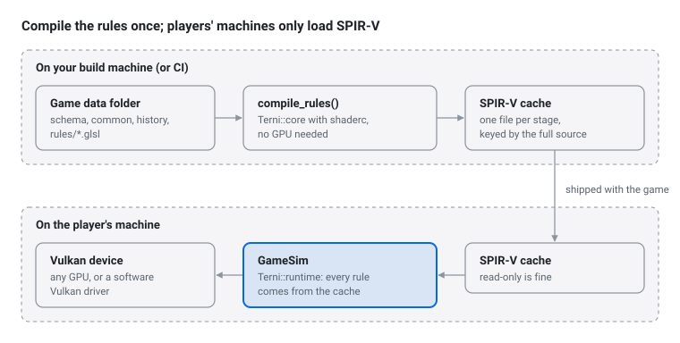
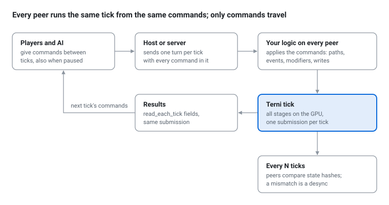

# Embedding Terni in an engine

Terni is a C++20 library with no engine dependency. It creates its own Vulkan
instance and device, so it works next to any renderer (Vulkan, DirectX, OpenGL) and in
programs without one (dedicated servers, tests). This guide covers adding it to a
build, running the tick in a game loop, shipping, saves and lockstep multiplayer.

**Using Flax Engine or Godot?**
[TerniIntegrations](https://github.com/ZBager/TerniIntegrations) has plugins for both
that do what this guide describes (device choice, background ticks, shipping the
compiled rules and the compiler, licence notices) and expose Terni to the engine's
scripting languages and editor. Their source is also a worked example of embedding
Terni.

## Adding Terni to your build

As a subdirectory (a git submodule or a copy):

```cmake
add_subdirectory(external/terni)
target_link_libraries(my_game PRIVATE Terni::core)
```

With FetchContent:

```cmake
include(FetchContent)
FetchContent_Declare(terni GIT_REPOSITORY https://github.com/ZBager/Terni.git GIT_TAG main)   # pin a release tag once there is one
FetchContent_MakeAvailable(terni)
target_link_libraries(my_game PRIVATE Terni::core)
```

Installed, with `find_package`:

```sh
cmake --install build --prefix /opt/terni
```
```cmake
find_package(Terni REQUIRED)            # CMAKE_PREFIX_PATH=/opt/terni
target_link_libraries(my_game PRIVATE Terni::core)
```

As a subproject, only the libraries are built; `TERNI_BUILD_TOOLS` and
`TERNI_BUILD_TESTS` turn the tools and tests on. Terni's libraries are static; if you
link them into a shared library (a plugin, or a library loaded from C#), set
`CMAKE_POSITION_INDEPENDENT_CODE ON` before adding Terni.

### Two builds: with and without the rule compiler

| Target | Compiles rules | Needs shaderc at run time | Use for |
| --- | --- | --- | --- |
| `Terni::core` | Yes, in process | Yes | Development, dedicated servers, games that let mods change rules on players' machines |
| `Terni::runtime` | No: every rule comes from a SPIR-V cache | No | Shipping to machines without shaderc |

Both have the same API; `terni::can_compile_rules()` tells them apart.
`-DTERNI_RULE_COMPILER=OFF` builds only `Terni::runtime` and does not look for shaderc.

## Starting a simulation

```cpp
auto game = terni::load_game("data/my_game");     // or a WorldBuilder
for (const auto& w : game->warnings) log(w.text());
if (!game->ok()) { for (const auto& e : game->errors) log(e.text()); return; }

terni::GameSimOptions options;
options.preference      = terni::DevicePreference::Discrete;  // or Integrated, Cpu
options.spirv_cache_dir = user_cache_dir + "/terni";          // compiled rules reused next start
terni::GameSim sim(*game, options);                           // `game` must outlive `sim`
log("simulating on " + sim.device_name());
```

### Choosing a device

- `DevicePreference::Discrete` (default): a dedicated GPU first, then integrated, then a
  CPU driver.
- `DevicePreference::Integrated`: leave the dedicated GPU to the renderer.
- `DevicePreference::Cpu`: a software Vulkan driver such as lavapipe; useful for
  dedicated servers and reference runs.
- `options.device_uuid`: the UUID of your renderer's physical device, to run on the
  same GPU (matched before the preference). For a Vulkan renderer.
- `options.device_luid`: the same for a renderer that uses DirectX on Windows: the
  adapter LUID that DXGI reports (`DXGI_ADAPTER_DESC::AdapterLuid`, 8 bytes, low part
  first). Matched after `device_uuid`.
- `options.device`: an explicit index from `terni::VulkanContext::list_devices()`, for
  a settings menu. Each `DeviceInfo` says whether it is usable and why not, and names
  its driver and driver version (`driver`), worth putting in bug reports.

Every usable device gives the same results, so players can choose freely.

### Machines without a usable GPU

Some machines have no Vulkan 1.3 device: an old GPU, a virtual machine, a server. A
software Vulkan driver runs the same compiled rules on the CPU, with the same results
bit for bit. Mesa's lavapipe is one, and it is what Terni's own tests run on. Ship its
library with your game and hand it to Terni when the system offers nothing:

```cpp
if (terni::pick_device() < 0)                                    // nothing usable here
    terni::add_vulkan_driver(install_dir + "/vulkan_lvp.dll");   // libvulkan_lvp.so on Linux
terni::GameSim sim(*game, options);                              // finds the added device
```

- Call `add_vulkan_driver` before you list or pick devices: the driver's devices are
  added to the system's, so indices change. It lasts for the whole process.
- On a machine with no Vulkan driver at all, `list_devices()` is empty and
  `pick_device()` returns -1; nothing throws until you start a `GameSim`.
- It throws `std::runtime_error` if the file is not a Vulkan driver, or if the Vulkan
  loader on the machine is older than 1.3.234 (late 2022).
- Terni still needs the Vulkan loader itself (`vulkan-1.dll`, `libvulkan.so.1`). GPU
  drivers install it; a machine that never had one needs it next to your game.
- A CPU is slower than a GPU, by how much depends on the world. In the
  [benchmark](benchmark.md), lavapipe on 12 threads computes a world of 1 million pops
  66 times slower than a laptop RTX 4050 and 21 times slower than an integrated Radeon
  760M, while a world of 50,000 pops still takes under 4 ms a tick. `DeviceInfo::cpu()`
  tells you which kind you got, so you can tell the player.
- A player with a working GPU can still choose the CPU device, and lockstep peers on
  GPUs and CPUs stay in step.

`terni_run <game folder> --driver <library>` runs a game with an added driver and
compares it with every other device.

### Locale

The generated shader code does not depend on the process locale. Your engine may set a
global C++ locale with digit grouping or a decimal comma; nothing changes.

## The per-tick loop

```cpp
// once, after starting
const uint32_t province = uint32_t(game->entity_index("province"));
const uint32_t owner_id = sim.read_each_tick(province, "owner");
const uint32_t pop_id   = sim.read_each_tick(province, "pop");

// every tick
apply_commands(sim);                      // write_field / add_modifier: applied before the next tick's stages
sim.tick();                               // uploads, all stages, readbacks: one GPU submission
std::span<const int32_t> owners = sim.tick_result(owner_id);   // valid until the next tick begins
std::span<const int32_t> pops   = sim.tick_result(pop_id);
copy_into_your_view_model(owners, pops);
```

- `tick()` blocks until the GPU is done. A tick of a large world takes a few
  milliseconds; to keep rendering meanwhile, split it (see below).
  `GameSim` is not thread-safe: call it from one thread at a time.
- `read_each_tick` copies only the rows in use, in the same submission as the tick.
  It is the cheap way to keep a host-side view of the fields the UI shows.
- `read_field` is a separate round trip to the GPU. Use it for occasional reads.
- `write_field` accepts any number of consecutive rows (`std::span`); the words are
  staged at once and uploaded with the next tick. With an `index`, it changes only some
  values of one row of a sized field: `write_field(province, "stock", p, grain, {amount})`
  sets one good and leaves the others as the rules left them.
- Writes made before the same tick apply in the order you made them, even where they
  overlap: the last write to a value wins.
- `last_tick_ms()` is the wall time of the last tick including transfers;
  `last_tick_gpu_ms()` is the GPU time of its stages. `stage_times()` breaks the GPU
  time down per stage, for your profiler or an editor panel:

  ```cpp
  for (const terni::StageTime& t : sim.stage_times())
      if (t.runs > 0)
          log(t.name + ": " + std::to_string(t.total_ms / double(t.runs)) + " ms a run, " +
              (t.ran ? std::to_string(t.last_ms) + " ms last tick" : "skipped last tick"));
  ```

  A stage with a schedule shows `ran = false` in the ticks it skips, and its average
  counts only the ticks it ran in. Stages named `terni_...` are Terni's own: the
  `terni_spawn_...` stages give out rows of dynamic entity types (`terni_spawn_bits`
  every tick, the others in ticks a spawn line runs in). `report()` gives the
  same times as text.
- To see what ticks cost beside a renderer, and what they cost its frames, run
  `terni_bench --frame-load 60` ([Benchmark](benchmark.md#beside-a-renderer)).

### When the device gets busy

A GPU that another program starts to use (a video encoder, a second game) can make
ticks many times slower. Terni watches for that:

```cpp
const terni::DeviceHealth health = sim.device_health();
if (health.slow) {
    // e.g. ticks took 0.4 ms and now take 9 ms: tell the player, or go elsewhere
    const int other = terni::pick_device(terni::DevicePreference::Integrated);
    if (other >= 0) sim.move_to_device(uint32_t(other));
}
```

- Ticks are judged 32 at a time, by their median, so a monthly stage or one late tick
  does not count. `usual_ms` is the lowest median so far, `recent_ms` the latest one.
- `slow` means the last 32 ticks took over 4 times the usual and at least 1 ms longer.
  For another threshold, compare `recent_ms` and `usual_ms` yourself.
- A tick is timed on the device's own clock, from its submission until its results are
  back, waiting behind other programs' work included. So it does not matter how often
  you poll a tick begun with `begin_tick()`: a host that looks once a frame is judged by
  the device, not by its frame rate. (`last_tick_ms()` is different: it counts until
  you first saw the tick done.) Where a device cannot read its clock that way (Vulkan's
  calibrated timestamps), a waited-for tick counts its wall time and a polled one the
  GPU time of its stages.
- `move_to_device(index)` continues on another device. The state moves bit for bit:
  modifier handles, `read_each_tick` ids and their last results stay valid, queued
  writes still apply at the next tick, and lockstep peers notice nothing. It takes
  about as long as starting the simulation, so do it at a quiet moment.
- Terni never moves by itself. Which device is better is your call: the other GPU may
  be the one your renderer needs.
- Health is measured again from zero after `move_to_device()` and `load()`.

### A tick that does not block

`tick()` is `begin_tick()` followed by `end_tick()`. Call them apart, and the GPU
runs the tick while your frame goes on:

```cpp
// in the frame loop
if (sim.tick_in_flight() && sim.tick_ready()) {
    sim.end_tick();                       // collect: ticks() advances, tick_result() moves on
    copy_into_your_view_model(sim.tick_result(owner_id), sim.tick_result(pop_id));
}
if (!sim.tick_in_flight() && time_for_next_tick) {
    apply_commands(sim);                  // the commands for the tick about to begin
    sim.begin_tick();                     // returns at once
}
render();                                 // tick_result() still holds the last collected tick
```

- While a tick runs, `write_field`, `add_modifier` and the other commands are for the
  tick after it, exactly as if you had made them after `end_tick()`. A timed modifier
  added while tick 10 runs lasts from tick 11, as it would if added after tick 10. The
  state never depends on when a host collects, so lockstep peers stay identical.
- `tick_result()` keeps the last collected tick's results until `end_tick()`.
  `modifier_total()` and `modifier_breakdown()` answer from the host as usual.
- Calls that need the GPU state as it is collect the tick first, and so block:
  `read_field`, `read_each_tick`, `save`, `load`, `snapshot`, `tick_checked`,
  `move_to_device`, and the
  first `modifier_total` of a key inherited through a ref field (once for each field
  of a key that inherits in several steps).
- One tick is in flight at a time: `begin_tick()` collects the previous one first.

### Host-side logic

A typical host does the work that needs a graph search or a decision on the CPU,
between ticks: it checks and applies players' commands, finds paths for moving units,
turns finished research or events into modifiers, and lets AI players decide. It reads
the last tick's results, decides, and writes. As long as that logic uses only integer
math on values every peer reads back identically, it stays deterministic.

### Creating and destroying entities

For an entity type marked dynamic (`dynamic = yes`, or `WorldBuilder::entity_dynamic`):

```cpp
const uint32_t row = sim.create_entity(army);        // terni::NO_ENTITY if the type is full
if (row != terni::NO_ENTITY) {
    sim.write_field(army, "home", row, {capital});   // fields start at their defaults
    my_armies.push_back({row, sim.entity_generation(army, row)});
}
sim.destroy_entity(army, other_row);                 // false if it was not alive
```

- Both take effect for the rules at the next tick, like `write_field`. The host's own
  view (`entity_alive`, `entity_generation`, `entities_alive`) changes at once.
- `read_field` shows what the device holds, so a row you created shows its defaults and
  the fields you wrote after the next tick. Rows that rules asked for are complete on
  the device as soon as their tick ends.
- A destroyed row rests for one tick, whoever destroyed it: `create_entity` right after
  `destroy_entity` gives another row, and the destroyed row is free again once the next
  tick has run. The rules see it dead for that whole tick; rows they ask for in it may
  already take it.
- `entities_free(army)` says how many rows `create_entity` would find now, resting rows
  left out, so a lockstep game can refuse a command for lack of room before applying
  it. `alive_bits(army)` gives every row's alive bit in one call (row `r` is bit
  `r % 32` of word `r / 32`), for a host that loops over the living rows itself.
- Every row below the starting count (the rows history or `WorldBuilder::create` made)
  is alive when the simulation starts. Leave room for later rows in the capacity, not
  by starting with more rows and marking some unused in a field of your own.
- `read_each_tick` on a dynamic type covers the rows in use, which grow during play up
  to the capacity: `tick_result()` holds as many rows as are in use when the tick ends,
  so copy what it gives, not a capacity's worth.
- Rows that rules asked for are created at the end of their tick, before anything you
  create afterwards. `create_entity` and `destroy_entity` collect a tick in flight
  first, so the same calls give the same rows on every peer, whenever each collects.
- Rows are reused. Keep the generation with the row, as above, and compare it before
  you act on an entity you remembered: `entity_alive(army, row) &&
  entity_generation(army, row) == generation`.
- To find the rows rules created, compare generations, or read the field you use to
  mark new rows (`read_each_tick(army, "fresh")`).
- Each tick brings back one bit per row of every dynamic type, in the same submission
  as the tick; that is how the host follows who is alive without waiting for the GPU.

### Modifiers from the host

```cpp
const uint32_t harvest = uint32_t(game->bundle_index("good_harvest"));
const uint32_t growth  = uint32_t(game->modifier_key_index("pop_growth"));
terni::ModifierHandle h = sim.add_modifier(harvest, planet, row, terni::fx::ONE, /*duration ticks*/ 12);
sim.set_modifier_scale(h, terni::fx::rate(2));      // false if the instance is gone
for (const auto& part : sim.modifier_breakdown(growth, planet, row))
    tooltip.add(game->bundles[part.bundle].name, part.value);
```

Handles stay safe after an instance expires: calls with a stale handle return false.
`modifier_total` and `modifier_breakdown` answer from host memory, without waiting for
the GPU.

## Shipping



Compiling the rules needs shaderc, which a player's system may not have (or may have in
a version built for another system). Compile them at build time instead:

```cpp
// a small build tool, linked with Terni::core; no GPU needed
auto game = terni::load_game("data/my_game");
terni::CompileStats s = terni::compile_rules(*game, "dist/spirv-cache");
```

Ship the cache folder with the game and link the game with `Terni::runtime`:

```cpp
terni::GameSimOptions options;
options.spirv_cache_dir = install_dir + "/spirv-cache";   // read-only is fine
terni::GameSim sim(*game, options);
```

If a rule is missing from the cache (a mod changed it), the start fails with one
error that names every missing stage. To let mods change rules anyway, ship the build
tool with the game and run it into the same cache folder when a start fails, then start
again: the tool needs shaderc, the game does not. Several programs and worlds may compile
into one cache folder at once. The cache key covers the full rule source
(including the generated prelude, so the schema counts, but not capacities, which are
set when the world starts), the GLSL library and the compile settings, but not the
compiler version: a cache built on one machine works on every other. Every file carries a content hash, so a damaged file is never handed to
the driver.

**If your engine has its own shader compiler.** Some engines export their own copy of
glslang or SPIRV-Tools, and a system shaderc loaded into the same process can bind to
those symbols and crash. Either link the game with `Terni::runtime`, or set
`options.cache_only = true` and fill the cache in a separate process (`compile_rules`
in a small tool) before starting.

## Rules you did not write

When players can install mods, rules you never saw run inside your game. What they can
and cannot do:

- **They run on the GPU, inside Terni's buffers.** A rule sees every field of the world
  and nothing else: no files, no network, no memory of your game or of other programs.
  It can still change any of the simulation's state, which is the point of a mod.
- **Accesses past the end of a field read 0 and write nothing**, on every device whose
  `DeviceInfo::robustness` is `BufferRobustness::Defined`, which is every current
  desktop driver. A broken mod then gives the same results on every machine. With
  `Bounded` (older drivers) the access stays inside the field's buffer but the result is
  up to the driver, and peers on different GPUs may desync.
- **A rule that runs too long loses the device.** The driver resets the GPU after a few
  seconds (two by default on Windows). Every call that ticks or reads the device then
  throws `terni::DeviceLost`. On Windows a reset affects every program on that GPU, so
  your renderer may lose its device as well.

```cpp
try {
    sim->tick();
} catch (const terni::DeviceLost&) {
    sim = std::make_unique<terni::GameSim>(*game, options);   // this device again, or another
    sim->load(last_autosave);
    tell_player("The simulation was restarted from the autosave; a mod may be at fault.");
}
```

- Save often enough that a restart loses little: an autosave every in-game month costs
  a read of the state.
- In a lockstep game, a peer that lost its device rejoins like a new player: a save
  from the host, then the commands since.
- Mods change the game checksum, so peers with different mods are refused before they
  play. `Game::warnings` holds a mod's order warnings; show them to the modder, since a
  rule with an order problem can desync a multiplayer game. `tick_checked()` confirms
  them in testing.

## Saves

```cpp
std::vector<uint8_t> bytes = sim.save();   // between ticks; the complete simulation state
sim.load(bytes);                           // any device; throws std::runtime_error on a bad save
```

A save holds the tick, the counts, every field and the modifier store (instances, free
slots, pending expiries). It is binary and versioned, and carries the game checksum
and a content hash. A truncated or damaged file, or a save from a different game or
mod, is refused, and the simulation is left as it was. Loading continues
bit-identically on any device. Store your own state (match settings, player names) next
to it.

### Saves from an earlier version of your game

When you patch your game, its checksum changes, and `load(bytes)` refuses your players'
saves. Load them by name instead:

```cpp
if (terni::save_checksum(bytes) != sim.checksum()) {
    for (const std::string& line : sim.load(bytes, terni::SaveMatch::ByName))
        log("save: " + line);                // what was fitted, one line each
} else {
    sim.load(bytes);
}
```

Entity types, fields and bundles are matched by name, so the save fits the patched game:

- A new field starts as the game describes it: with its history values for an entity
  type that is not dynamic, at its default for a dynamic one (its rows have been reused
  since the start). A new entity type starts with its history.
- A removed field or entity type is dropped, and so are the modifier instances on a
  removed entity type or of a removed bundle; their handles become stale.
- A sized field may get more or fewer values per row: the first ones are kept, new ones
  start at their default. An entity type's capacity may grow, or shrink as long as the
  rows in use still fit.
- Changed rules, defines and bundle values simply apply from the next tick: modifier
  totals are worked out again from the instances.
- A field whose type or ref target changed, or an entity type that became dynamic or
  stopped being so, is refused, with the simulation left as it was. Convert such a save
  in your own code first: load it into the old version of the game, change the values,
  and save it again.

`load` returns one line per thing it fitted, so you can log them or tell the player.
Peers in a lockstep game still compare the full checksum: a game loaded by name is then
saved again, and that save is what the other players load.

## Lockstep multiplayer



Because every peer computes the same state from the same inputs, only commands need to
travel:

1. **Before playing**, peers compare `terni::game_checksum(*game)`, after any
   `set_capacity`. Different rules, defines, capacities or mods are refused here, not
   discovered as a desync later.
2. **Every tick**, the host sends one turn holding every command for that tick. Each
   peer applies the commands with the same host-side logic, then calls `tick()`.
3. **Every few ticks**, peers compare a state hash and stop on a mismatch:

   ```cpp
   const std::vector<terni::FieldHash> fields = sim.field_hashes();   // computed on the device
   uint64_t hash = terni::combine(fields);
   ```

   `field_hashes()` hashes every field on the device and brings back two words per
   field, a fraction of a millisecond on a discrete GPU even for a million pops (reading
   the whole state back with `snapshot()` takes about 30 ms there). On a mismatch,
   `terni::entity_hashes(fields)` says which entity type differs, and the per-field
   hashes which field.
4. **A joining player** receives a save and the commands since.
5. **To find what diverged**, have both peers save at the same tick and compare the two
   saves with `terni_diff a.sav b.sav`. It needs no GPU and no game folder, and names the
   entity types, fields and rows that differ, with the values. In code,
   `terni::differences(terni::save_snapshot(a), terni::save_snapshot(b))` gives the same
   list.

Terni does not include networking; it gives you a state that is the same everywhere.

## Wrapping Terni for C# or other languages

Terni's API is C++. A C API in Terni itself, with a shared library build, is on the
[roadmap](roadmap.md). Until then, engines in other languages add a small C API in a
shared library of their own: `extern "C"` functions over a handle, catching every
exception and returning an error code, with the message available through a
`last_error()` call. Keep the glue thin: load, start, tick, read and write fields by
name, modifiers, save and load. Engines whose own headers are not C++20, or that build
without exceptions, can start from `terni_bridge` in
[TerniIntegrations](https://github.com/ZBager/TerniIntegrations): Terni behind a C++14
interface where no call throws.
